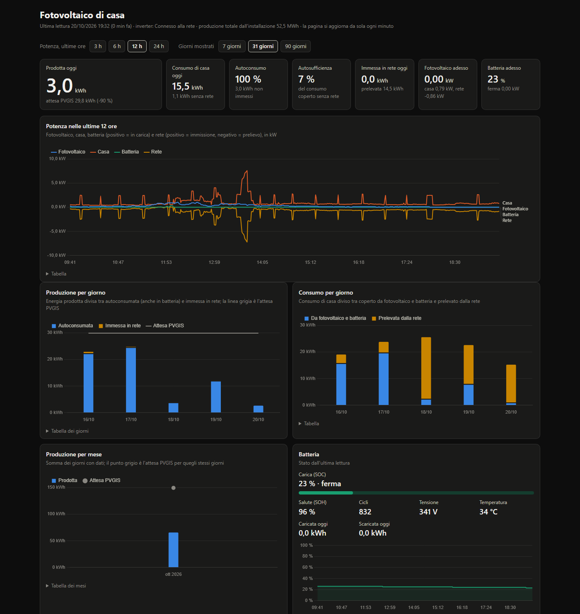
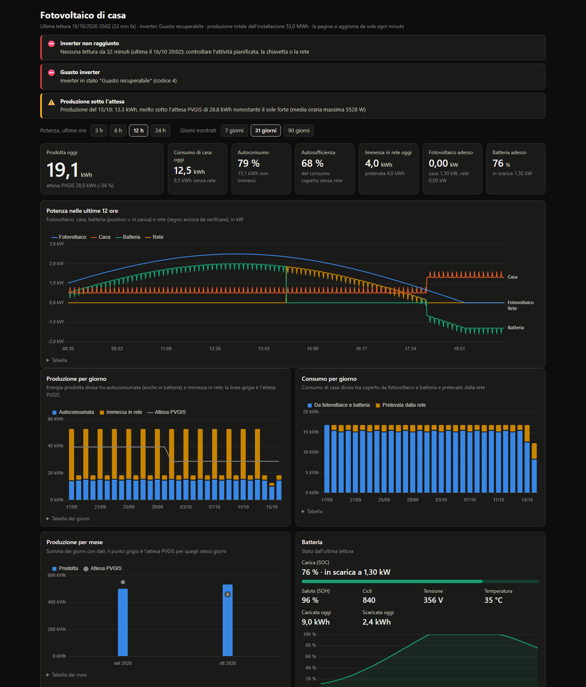

# Monitoraggio fotovoltaico ZCS Azzurro

Progetto personale per leggere, salvare e visualizzare i dati del mio impianto
fotovoltaico con inverter ibrido ZCS Azzurro 3PH HYD10000 ZSS e batteria.
Indirizzi, seriali, token e posizione dell'impianto stanno solo nel file `.env`,
escluso da git (modello in `.env.example`).

Stato: Tappa 1 (raccolta dati) in corso, Tappa 2 (dashboard) fatta: costruita
il 16/10/2026, confronto con PVGIS attivo dal 20/10/2026 (kWp stimati, da
affinare). Vedi `STATO.md` e `PIANO.md`.

## Come funziona

- **Lettura locale (strada A):** la chiavetta Wi-Fi del produttore espone
  l'inverter in Modbus TCP sulla rete di casa (porta 8899, protocollo
  Solarman V5). Lo script usa la libreria `pysolarmanv5` e legge i registri
  descritti in `registri.py`. Solo lettura.
- **API cloud (strada B):** le "API Terze Parti Azzurro" di ZCS, usate per
  confrontare le letture locali e recuperare lo storico (token da richiedere a ZCS).
- **Dashboard locale (Tappa 2):** un piccolo server Python legge `dati.db` in
  sola lettura e mostra una pagina web con grafici, confronto con la produzione
  attesa (PVGIS) e avvisi.

Le scelte e le fonti sono in `tappa0_ricognizione.md`.

## Dashboard



Avvio (dalla cartella del progetto, con l'ambiente virtuale attivo o con
`.venv\Scripts\python.exe`):

```bash
python dashboard.py
```

poi aprire http://127.0.0.1:8780 nel browser. La pagina si aggiorna da sola ogni
minuto. Porta diversa: `--porta 8790` oppure `DASHBOARD_PORTA` nel `.env`.
Il server ascolta solo su 127.0.0.1 (si vede solo da questo PC) e si ferma con Ctrl+C.

Cosa mostra:

- **Numeri di oggi:** energia prodotta (con l'attesa PVGIS e lo scarto in
  percentuale), consumo di casa, autoconsumo, autosufficienza, energia immessa e
  prelevata, potenza fotovoltaica e stato della batteria in questo momento.
- **Potenza nelle ultime ore** (3, 6, 12 o 24): fotovoltaico, casa, batteria e
  rete minuto per minuto.
- **Produzione per giorno** (7, 31 o 90 giorni), divisa tra autoconsumata e
  immessa in rete, con la linea dell'attesa PVGIS.
- **Consumo per giorno**, diviso tra coperto da fotovoltaico e batteria e
  prelevato dalla rete.
- **Produzione per mese** su tutto lo storico, con l'attesa PVGIS per i giorni
  che hanno dati.
- **Batteria:** carica (SOC), salute (SOH), cicli, tensione, temperatura,
  energia caricata e scaricata oggi, andamento della carica nelle ultime ore.
- Sotto ogni grafico c'è una **tabella** con gli stessi numeri.

Definizioni usate (vedi anche `calcoli.py`):

- i contatori giornalieri sono quelli dell'inverter, che si azzerano a
  mezzanotte; il valore del giorno è l'ultima lettura del giorno;
- autoconsumo = prodotta − immessa (compresa l'energia messa in batteria);
- autosufficienza = consumo − prelevata (consumo coperto senza la rete);
- batteria con potenza positiva = in carica; il segno della potenza di rete
  (immissione/prelievo) non è ancora verificato con l'app.

### Produzione attesa (PVGIS)

L'attesa viene dall'API pubblica **PVGIS v5.3** del Joint Research Centre
(strumento PVcalc, vedi `pvgis.py` per la fonte): per ogni mese PVGIS dà la
produzione media giornaliera di un impianto con quella potenza, posizione,
inclinazione e orientamento, calcolata su quasi vent'anni di dati satellitari.
L'attesa di un giorno è la media del suo mese: una giornata nuvolosa sta sotto,
una limpida sopra. Non serve nessuna chiave; la risposta si salva in
`pvgis_cache.json` (escluso da git, contiene la posizione) e si richiede di
nuovo dopo 30 giorni o se cambiano i parametri.

Parametri nel `.env` (vedi `.env.example`): `IMPIANTO_KWP`, `PVGIS_LAT`,
`PVGIS_LON` obbligatori; `PVGIS_INCLINAZIONE` (vuoto = la sceglie PVGIS),
`PVGIS_ORIENTAMENTO` (0 = sud, 90 = ovest, −90 = est), `PVGIS_PERDITE` (14 %
è il valore proposto da PVGIS). Senza questi parametri la dashboard funziona
lo stesso, ma senza attesa e senza l'avviso di produzione bassa.

### Avvisi

- **Inverter non raggiunto:** nessuna lettura da più di 10 minuti.
- **Guasto inverter:** stato 4 (guasto recuperabile) o 5 (guasto permanente).
- **Produzione sotto l'attesa:** in una giornata di sole la produzione è sotto
  la metà dell'attesa PVGIS. Non c'è un sensore di irraggiamento, quindi "di
  sole" vuol dire che in almeno un'ora la potenza media del fotovoltaico ha
  superato metà dei kWp (una media oraria, non il picco, per non scambiare una
  schiarita per una giornata limpida). Si valuta per ieri e, dalle 18 in poi,
  per oggi; un giorno con troppe letture mancanti viene saltato.



### Prova con dati finti

Per vedere la dashboard piena e gli avvisi senza aspettare l'inverter:

```bash
python genera_db_finto.py prova\finto.db
```

crea 30 giorni di letture finte (ieri con un "guasto" a metà giornata, ultima
lettura 25 minuti fa con stato di guasto), poi:

```bash
python dashboard.py --db prova\finto.db --porta 8781 --env prova\finto.env
```

dove `finto.env` contiene i parametri PVGIS di prova (per esempio una città,
non la posizione di casa). `--env` evita di toccare il `.env` vero.

### Scelte tecniche

- Server con la libreria standard di Python (`http.server`): niente da
  installare e niente da configurare; basta per una pagina usata da una persona
  sulla propria rete. Un framework (Flask, FastAPI) avrebbe senso solo con più
  pagine, utenti o autenticazione.
- Grafici con Chart.js caricato da CDN: la pagina ha bisogno di internet per
  disegnarli, ma i dati non escono dal PC. Per lavorare del tutto offline basta
  scaricare `chart.umd.min.js` accanto a `dashboard.html` e cambiare il `src`.
- I calcoli (giorni, mesi, autoconsumo, attesa, avvisi) sono in `calcoli.py`,
  funzioni senza database né rete, così si provano con dati finti.
- Il database si apre in sola lettura (`mode=ro`): la dashboard non può
  scrivere in `dati.db` e non contatta mai l'inverter.

## File

- `registri.py`: mappa dei registri Modbus con fonte e convenzioni.
- `lettura_prova.py`: prima lettura di prova, stampa i valori a schermo.
- `lettore.py`: legge i blocchi di registri da un client Modbus (vero o finto).
- `archivio.py`: salva e rilegge le letture su SQLite (`dati.db`, tabella `letture`).
- `raccolta.py`: raccoglie e salva, una volta (`--una-volta`) o in ciclo (`--intervallo 60`); log in `logs/raccolta.log`; `--prova-rete` per la diagnosi.
- `scoperta.py`: trova la chiavetta in rete dal suo seriale (scoperta automatica dei logger Solarman).
- `raccolta_una_volta.bat`: lanciatore alternativo per l'Utilità di pianificazione (apre una finestra).
- `calcoli.py`: aggregazioni per giorno e mese, serie di potenza, batteria, attesa, avvisi.
- `pvgis.py`: client dell'API PVGIS con cache su file.
- `dashboard.py` e `dashboard.html`: server locale e pagina della dashboard.
- `genera_db_finto.py`: database finto per provare la dashboard e gli avvisi.
- `tests/`: test automatici con dati finti, `python -m pytest tests -q` (50 test).
- `.env.example`: modello per il file `.env` con IP, seriali, token e parametri PVGIS (mai in git).
- `requirements.txt`: librerie Python (la dashboard non ne aggiunge).

## Raccolta automatica (Windows)

Un'attività pianificata chiamata **"Fotovoltaico raccolta"** lancia ogni minuto
`.venv\Scripts\pythonw.exe raccolta.py --una-volta` (senza finestre, circa 4 s e
25 MB per lettura) finché l'utente è connesso. Gestione da PowerShell:

```powershell
Get-ScheduledTaskInfo -TaskName "Fotovoltaico raccolta"     # ultimo avvio ed esito
Disable-ScheduledTask -TaskName "Fotovoltaico raccolta"     # sospendere
Enable-ScheduledTask  -TaskName "Fotovoltaico raccolta"     # riprendere
Unregister-ScheduledTask -TaskName "Fotovoltaico raccolta"  # rimuovere
```

Le letture vanno in `dati.db` (una riga al minuto, meno di 1 MB al giorno),
gli errori in `logs/raccolta.log`. Una risposta corrotta dalla chiavetta
(errore CRC, capita) viene ritentata fino a tre volte prima di contare come
lettura persa. L'attività gira solo con l'utente connesso: a PC spento o
disconnesso restano buchi nei dati (la dashboard li segnala come letture mancanti).

### Se la chiavetta cambia indirizzo

Il router assegna gli indirizzi con il DHCP e può cambiarli: il 16/10/2026
sera è successo e la raccolta è rimasta ferma 15 ore con l'errore
"No socket available". Da allora `raccolta.py`, se la chiavetta non risponde
all'indirizzo del `.env`, la cerca in rete con la scoperta automatica dei
logger Solarman (`scoperta.py`: un pacchetto UDP di broadcast sulla porta
48899; la risposta contiene il seriale, che deve coincidere con
`LOGGER_SERIAL`), legge dal nuovo indirizzo e lo salva in `.chiavetta_ip`
(escluso da git), che viene provato per primo nelle letture successive.
Per controllare la situazione senza stampare indirizzi:

```bash
python raccolta.py --prova-rete
```

La soluzione definitiva è riservare un indirizzo fisso alla chiavetta nella
pagina del router (prenotazione DHCP sul suo indirizzo MAC) e, volendo,
aggiornare `LOGGER_IP` nel `.env` copiandolo da `.chiavetta_ip`.

## Avvio rapido

1. Copiare `.env.example` in `.env` e compilarlo.
2. Installare le librerie: `pip install -r requirements.txt` (meglio in un ambiente virtuale).
3. Lanciare `python lettura_prova.py` per vedere i valori, oppure `python raccolta.py --una-volta` per salvarli nel database.
4. Lanciare `python dashboard.py` e aprire http://127.0.0.1:8780.

## Licenza

Codice e documentazione sono rilasciati con licenza MIT (vedi `LICENSE`).
